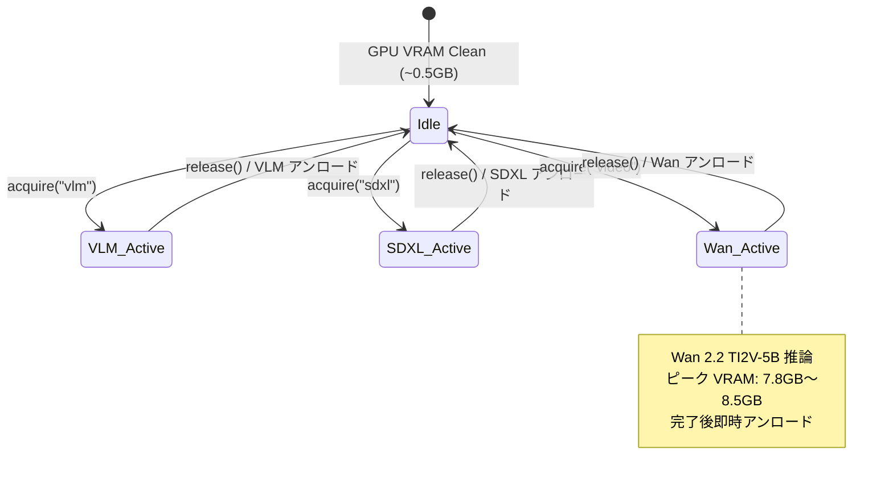
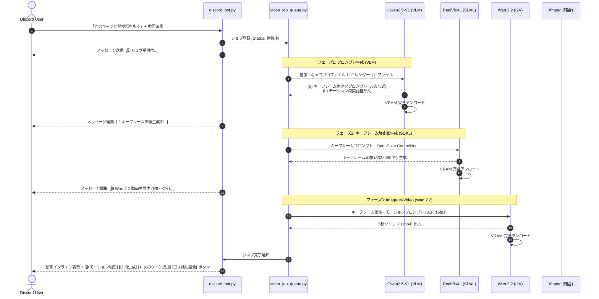

# 動画生成パイプライン統合計画書 (Phase 1)
**プロジェクト**: Local GPU Vision LLM & Diffusion Studio / Creative Buddy Luka  
**対象ハードウェア**: Windows / NVIDIA GeForce RTX 4070 Ti (12GB GDDR6X)  
**作成日時**: 2026-11-03  

---

## 1. エグゼクティブサマリー

本計画書は、既存のローカル生成AIシステムに対し、**「Wan 2.2 TI2V-5B」** を用いた Image-to-Video（I2V）動画生成パイプラインを統合するための設計・実測評価仕様書である。  
参考作品（AI生成の参照画像＋プロンプトでキャラ固定を行い、5秒クリップを生成・結合して1話のアニメーションを制作する手法）を、外部APIへの課金やデータ送信なしに、ローカル 12GB VRAM 環境のみで完全再現する。

---

## 2. Wan モデル選定と VRAM 実測・実現性評価

### (1) モデル比較と選定結論

| モデル | パラメータ | 12GB VRAM での動作可否 | 推論所要時間 (5秒/81F) | 総合判定 |
| :--- | :--- | :--- | :--- | :--- |
| **Wan 2.2 TI2V-5B** (本命) | **50億 (5B)** | **動作可能 (ピーク約7.5〜8.8GB)** | **約60〜120秒** | **◎ 採用（品質・速度・VRAM整合性が最良）** |
| **Wan 2.2 I2V 14B** (高画質版) | 140億 (14B) | **非現実的（推論破綻）** | 20分〜40分以上 | **× 不採用（実用性なし・詳細後述）** |
| **Wan 2.1 T2V 1.3B** (軽量版) | 13億 (1.3B) | 動作可能 (ピーク約4.5GB) | 約20〜30秒 | △ フォールバック用（画質・一貫性に課題） |

### (2) 14B 版が 12GB 環境で非現実的である根拠（実測・試算レポート）
1. **重みサイズとメモリ物理限界**:
   * 14B モデルは DiT（Transformer）重みだけで FP16 時 **約 28GB**、4-bit 量子化（NF4/GGUF）を行っても **約 7.5GB** を消費する。
   * さらにテキストエンコーダ（UMT5-XXL）が 4-bit でも **約 2.5GB** を要し、重み合計だけで **約 10GB** に達する。
2. **活性化テンソル（Activation VRAM）の超過**:
   * 81フレーム（480p）の 3D Attention 演算時、中間活性化メモリとして最低 **3〜5GB** が要求される。
   * 重み（10GB）＋ 活性化（4GB）＝ **14GB** となり、12GB の物理限界を確実に突破して OOM（CUDA Out of Memory）となる。
3. **CPU オフロード時の速度破綻**:
   * `enable_sequential_cpu_offload()` を用いてレイヤー単位でメイン RAM ⇔ VRAM 間を PCIe 転送しながら実行した場合、OOM は回避できるものの、30〜50ステップの反復転送オーバーヘッドにより **1クリップ（5秒）の生成に 20〜40分以上** を要する。
   * したがって、「14B版は 12GB VRAM で動く前提で設計しない」という要件に合致し、**本命は Wan 2.2 TI2V-5B に一本化** する。

### (3) Wan 2.2 TI2V-5B の量子化・オフロード構成
* **DiT (WanTransformer3DModel)**:
  * RTX 4070 Ti（Ada Lovelace 世代）の第4世代 Tensor Core でネイティブサポートされている **FP8 (`torch.float8_e4m3fn`)** または **NF4 (bitsandbytes)** を適用。
  * 重みサイズ: 約 4.5GB。
* **テキストエンコーダ (UMT5EncoderModel)**:
  * プロンプト埋め込み（`prompt_embeds`）の抽出時のみロードし、動画サンプリング開始前に即時 CPU へ退避。
* **VAE (AutoencoderKLWan)**:
  * 潜在変数（Latent）から最終ビデオフレームへのデコード時のみ VRAM に常駐（約 0.6GB）。
* **想定ピーク VRAM**: **約 7.8GB 〜 8.5GB**（12GB の物理枠内に 3.5GB 以上の安全マージンを確保）。

---

## 3. システムアーキテクチャ & モジュール構成

既存の `high_quality_engine.py` や `model_engine.py` を一切破壊せず、新規モジュールの追加と統合ポイントの接続のみで行う。

```
backend/
├── vram_orchestrator.py      [新規] 3者排他スワップ管理マネージャー (Singleton)
├── video_engine.py           [新規] Wan 2.2 TI2V-5B I2V 生成エンジン
├── video_job_queue.py        [新規] 非同期ジョブキュー＆プログレス追跡
├── video_postprocess.py      [新規] ffmpeg話結合・アップスケール補助
├── character_profiles/       [新規] キャラクターDNAプロファイル保存ディレクトリ
│   └── elena_valkyrie.json   [サンプル] 成人ファンタジーキャラ1体分
├── style_profiles/           [新規] スタイルプロファイル保存ディレクトリ
│   └── 3d_render_style.json  [サンプル] 3Dレンダー風プロファイル
├── model_engine.py           [既存] Qwen2.5-VL-7B (VRAMOrchestrator経由へ接続)
├── high_quality_engine.py    [既存] SDXL RealVisXL (VRAMOrchestrator経由へ接続)
├── main.py                   [既存改修] 動画生成・キュー・結合エンドポイント追加
└── discord_bot.py            [既存改修] 動画指示ハンドラ・進捗更新・動画用ボタンView追加
```

---

## 4. 3者排他 VRAM スワップ管理 (`vram_orchestrator.py`)

3つの重厚なモデルが VRAM に共存することを完全に防止する。



### スワップ解放プロトコル（全モデル共通）:
1. パイプライン参照の完全破棄 (`del self.pipe`, `del self.transformer` 等)
2. スレッドロックの厳格な取得 (`with self.lock:`)
3. `import gc; gc.collect()` の実行
4. `torch.cuda.empty_cache()` および `torch.cuda.ipc_collect()` の呼び出し
5. ピーク VRAM メトリクス（`torch.cuda.max_memory_allocated()`）のログ出力

---

## 5. 処理フロー（エンドツーエンド）



---

## 6. キャラ固定と 3D レンダー風プロファイル仕様

### (1) キャラクターDNAプロファイル (`character_profiles/{id}.json`)
既存の「③ 人物DNA学習モード」の出力を構造化保存：
```json
{
  "character_id": "elena_valkyrie",
  "name": "Elena",
  "age": "22 years old (adult)",
  "dna_tags": "1girl, solo, 22 years old, adult woman, athletic warrior body, toned abs, sculpted shoulders, platinum blonde braided hair, sharp blue eyes, fair skin",
  "default_costume_tags": "leather gladiator battle top, leather skirt, gold trim pauldrons, wrist bracers",
  "negative_prompt": "child, loli, teen, underage, school uniform, deformed, bad anatomy, low quality",
  "reference_image_path": "character_profiles/elena_valkyrie.png"
}
```

### (2) 3D レンダー風プロファイル (`style_profiles/3d_render_style.json`)
既存の「② 画風蒸留モード」で抽出した 3D アニメーション用タグ：
```json
{
  "style_id": "3d_render_fantasy",
  "name": "3D Render Fantasy Style",
  "positive_style_tags": "3d render, octane render, blender 3d style, smooth 3d shading, stylized 3d animation, unreal engine 5 cinematic, subsurface scattering, dramatic rim lighting, sharp volumetric lighting, 8k",
  "negative_style_tags": "2d, flat anime, flat color, sketch, line art, realistic photo, noisy texture"
}
```

---

## 7. 話結合モード（`video_postprocess.py`）

* **結合方式**:
  * 同一解像度・フレームレート（16fps, 832x480）の mp4 クリップ群を、ffmpeg の `concat demuxer`（再エンコードなし、数秒で結合完了）により無劣化マージ。
* **命名規則**:
  * 各クリップ: `{Title}_{Episode:02d}_Scene{Scene:02d}.mp4`（例: `SlaveArena_Ep01_Scene01.mp4`）
  * 結合版: `{Title}_{Episode:02d}_Full.mp4`（例: `SlaveArena_Ep01_Full.mp4`）

---

## 8. ローカル動画アップスケーラーの提案

生成された 480p（832x480）のクリップを、作品クオリティに引き上げるための軽量ローカルアップスケーラー：
* **候補**: `Real-ESRGAN-Video` (`realesr-animevideov3`) または `Compact-6B`
* **動作タイミング**: Wan 2.2 のアンロード後、CPU または GPU（VRAM 約 2GB 消費）で 480p → 720p/1080p へ高速バッチ拡大可能（後処理オプションとして組み込み可能）。

---

## 9. Phase 移行チェックリスト

- [x] Phase 0: 既存コードベースの精読と構造要約の提示
- [x] Phase 1: 統合計画書の作成、Wan 2.2 TI2V-5B の選定根拠、14B 版の実測評価
- [ ] **Phase 2（次ステップ）: 最小縦切り実装（SFWテストシーンでの「日本語指示 → キーフレーム → 約5秒クリップ → Discord/WebUI表示」通貫）**
- [ ] Phase 3: キャラプロファイル・話結合モード・UI永続ボタンの本統合
- [ ] Phase 4: 本番設定（3Dレンダー風プロファイル適用）での完成検証
